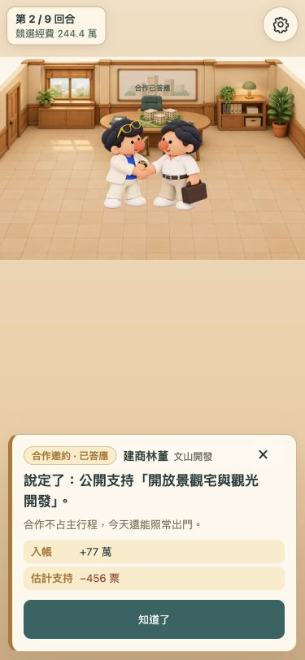
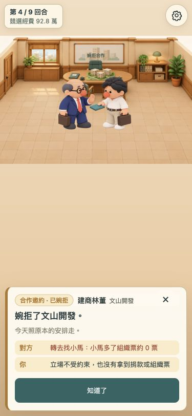
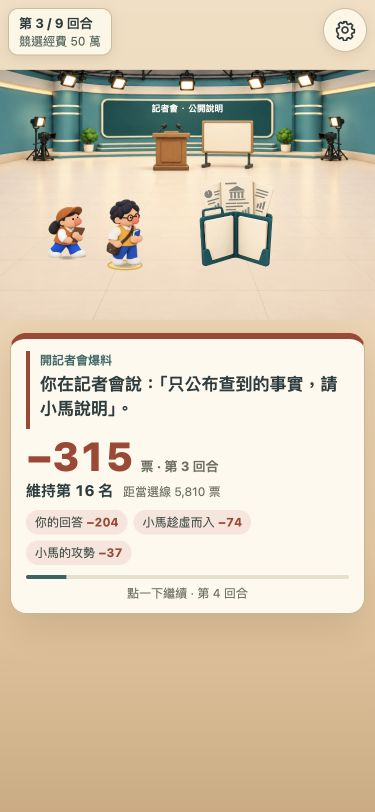
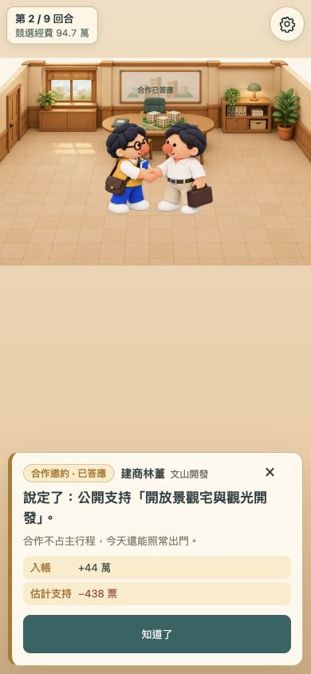
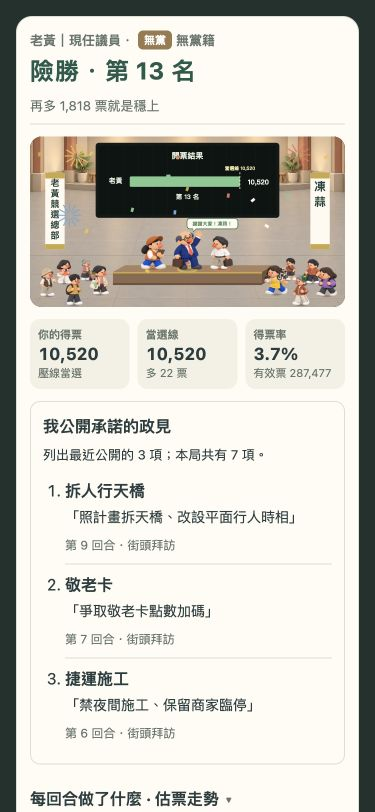
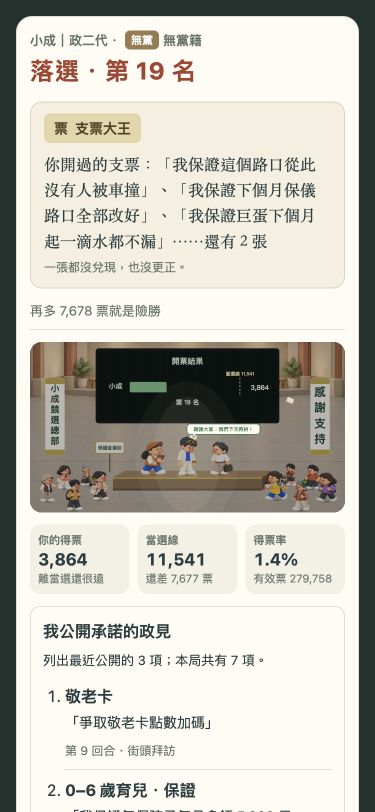
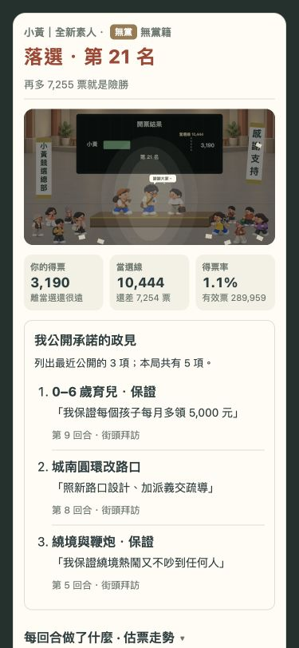

# 手機辦公室事件視覺

對應 R03a、R02、R08、R09、R13、R14。以 `office.html` 的手機辦公室為主要驗收入口。沿用原本霧面玩具人物與場景，三種身分的衣服、臉型與主要配件保持可辨識。

| 場景 | 觸發 | 畫面與動態 |
| --- | --- | --- |
| 開票中 | 尚未揭曉結果 | 原本中性人物，不提前顯示表情 |
| 當選 | 引擎結果 `elected` | 對應身分的開心、舉手表情，沿用彩紙與煙火 |
| 落選退保證金 | `refunded` | 對應身分的失望表情，保留退保證金標記 |
| 落選沒收保證金 | `forfeited` | 失望表情，沿用更暗燈光及掉落文宣 |
| 記者會等待回答 | `press` 問題 | 獨立記者會背景、關閉的文件夾 |
| 公布資料 | `press` 已結算回顧 | 關閉 → 打開 → 文件亮出，約 1.2 秒，停止在最後一格 |
| 公開更正 | 回顧回答 `tip_correct` | 更正標題、關閉文件夾，避免誤示再次公布 |
| 建商合作邀約 | `offerView().id === developer` | 會客室、模型桌、目前候選人與林董 |
| 接受合作 | 引擎接受成功之後 | 對應身分與林董握手，短暫入場動態 |
| 婉拒合作 | 引擎婉拒成功之後 | 對應身分抬掌拒絕、林董收起文件 |
| 主動拜訪建商募款 | 已結算報告 `player.dealt.id === developer` | 接受合作的會客室與握手畫面，金額讀原本報告 |
| 街坊小額募款 | 其他 `fundraise` | 原本街坊募款攤，不誤用建商合作圖 |
| 立看板、送禮、催票、造勢、上電視 | 原本已結算的行動／加碼 | 保留既有對應回顧演出 |

這批素材只負責表達場景，不表示爆料真實、合作有利或保證當選。遊戲引擎、平衡參數與存檔格式不變。動畫不呼叫任何引擎結算；合作圖片只在 `respondOffer` 成功後選擇，拜訪圖片只讀已結算的 `dealt`。

## 素材

`dist/assets/office-events/` 含七份執行期 WebP：兩份三身分結局表情、記者會背景、三格文件道具、建商會客室背景、接受／婉拒的三身分雙人圖集。使用 OpenAI ImageGen 原創生成，參考本專案既有候選人、支援人物與場景；沒有新增第三方遊戲人物或商標。

生圖方向：柔和霧面黏土玩具質感，保留小黃的黃背心、眼鏡、藍書與側背包，小成的米白西裝、藍衫與黃墨鏡，老黃的深藍西裝、珊瑚領帶、眼鏡與公事包。林董沿用白衫、米色褲與公事包。背景不畫人物與可辨識文字；透明圖集保留頭腳及動作邊界。

原始 PNG 僅做 WebP 編碼，沒有縮放或更換角色。`manifest.json` 記錄原圖與 WebP SHA-256、像素尺寸與檔案大小。表情依各姿勢的實際裁切與鞋底位置對齊；雙人圖集使用 724×724 的方形視窗，避免露出鄰格。新素材合計約 0.96 MB，網站套件保留原本 10 MiB 上限，原始生圖與驗收截圖不進 Pages。

## 相容性與退化

原版外觀仍可使用，記者會與建商分別回到原版電視／募款場景。新圖片失敗時只在該圖回退：背景使用既有背景、結局用同身分中性人物、雙人圖用既有兩位人物、文件道具隱藏。回退不修改選戰狀態。

合作畫面收起、開其他面板或出發時回到正常辦公室。已回答合作後重載維持結果，不重播或重新入帳。結局表情透過共用 `DayArt.countNight` 同時出現在原版入口及辦公室入口；事件動畫樣式限定辦公室。減少動態時，文件直接顯示最後一格，會面入場動畫關閉。

## 驗證

自動回歸涵蓋三身分及三結局、開票不提前揭露、合作接受／婉拒與存檔重載、雙擊不重複入帳、主動拜訪建商與小額募款分流、爆料及更正、素材失敗回退、圖集裁切與網站打包依賴。手機瀏覽器驗收使用 ChatGPT in-app browser（Chromium），375×812、390×844；另檢查 1280×720 會面布局。這些是實際 `office.html` 頁面截圖，不是素材合成。除了開局到主動拜訪建商的操作，其餘透過相同引擎、合法行動產生的測試存檔定位到邀約、記者會與完整九回合的結局，再以畫面操作接受／婉拒／爆料。沒有手動改寫勝負或選票；不是人類完整九回合遊玩或實機 iPhone 驗收。

- 小黃與小成接受合作、老黃婉拒，服裝與身分正確，沒有鄰格人物。
- 記者會回答前保持關閉文件夾；回答後可觀察關閉、打開與文件亮出。按住回顧繼續閱讀，動畫不會阻止操作。
- 三種結果分別檢查老黃當選、小成落選退保證金、小黃落選沒收保證金。三種身分 × 三種結局另有 renderer 自動回歸。
- 接受合作後重載回到辦公室：小黃由 50.7 萬收取 44 萬後為 94.7 萬；小成由 167.4 萬收取 77 萬後為 244.4 萬，重載金額不再增加。
- 檢查過的頁面沒有瀏覽器錯誤／警告。減少動態分支與圖片失敗由原碼和自動回歸檢查，未切換作業系統減少動態設定，也未做瀏覽器故意斷圖驗收。

| 實際頁面截圖 | |
| --- | --- |
|  |  |
|  |  |
|  |  |
|  | |

已執行 `test:v13`、`test:v12`、`test:v11`、`test:v10`、`test:pages`；本次相關定向回歸包含辦公室 555 項斷言與素材 338 項檢查。測試結果不代表平衡門檻、真人耗時或實機音效驗收。平衡測試與最終完整性結果在 PR 交接中分別記錄。
